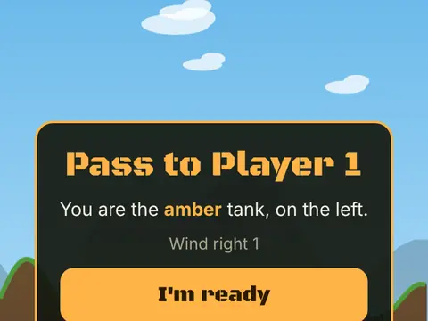

# Artillery Duel

**Tank artillery, friend or CPU.**

▶ **Play:** [https://dougm1966.github.io/1off-1file-games/games/artillery-duel/](https://dougm1966.github.io/1off-1file-games/games/artillery-duel/) · or open [`index.html`](index.html) in any browser

| | |
|---|---|
| Type | Two players |
| Inspired by | turn-based artillery games |
| Built for | phones (portrait, touch); also works with mouse and keyboard |

## How it plays

Turn-based tank artillery on destructible terrain, pass-and-play or against a CPU at three skill levels. Wind, six weapons, falling damage and limited fuel for moving.

> Tank duel on destructible ground. On your turn, drag back from your tank like a slingshot (the dotted arc shows the start of the shot) and let go to fire. Or use the AIM and POWER buttons and press FIRE. Mind the wind arrow. Wreck the other tank to win the round.

## Controls

Drag back from your tank like a slingshot and let go to fire; a dotted arc shows the start of the shot. Or use the AIM, POWER, MOVE, WEAPON and FIRE buttons under the board.

## Rules and features

- A pass card between turns in two-player games.
- A header mute button and pause button; the game pauses itself when you switch apps.

## Settings

| Setting | Options |
|---|---|
| Mode | 2 players · CPU easy · CPU normal · CPU hard |
| Wind | Off · Light · Wild |
| Terrain | Random · Hills · Mountains · Canyon · Plateaus |
| Rounds | 1 · Best of 3 · Best of 5 |
| Weapons | Shells only · Classic 3 · Full arsenal |
| Tank fuel | None · Some · Lots |
| Drag release | Fires · Only aims |
| Aim arc | Short · Long · Off |
| Controls side | Buttons right · Buttons left |
| Sound | On · Off |
| Vibration | On · Off |

## Challenges

A checklist in the menu that saves on your device:

- [ ] Win a round with a direct hit
- [ ] Win a round without taking damage
- [ ] Finish a tank with falling damage
- [ ] Finish a tank with a Roller
- [ ] Win a round in 3 shots or fewer
- [ ] Win a match in wild wind
- [ ] Beat the hard CPU in a match

## Look and feel

- Type: system UI
- Palette: 
- Layout: 

## Technical notes

- One self-contained HTML file: inline CSS and JavaScript, no build step, no libraries. The only external request is Google Fonts, with system-font fallbacks.
- Settings, unlocked levels, best scores and challenges are stored in the browser's `localStorage`, per device.
- Respects phone safe areas (notches) and never scrolls sideways.
- Recreate or remix it with [`PROMPT.md`](PROMPT.md).
