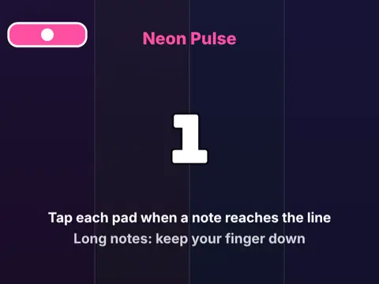

# Beat Tap

**Rhythm game with 10 original songs.**

▶ **Play:** [https://dougm1966.github.io/1off-1file-games/games/beat-tap/](https://dougm1966.github.io/1off-1file-games/games/beat-tap/) · or open [`index.html`](index.html) in any browser

| | |
|---|---|
| Type | Arcade |
| Inspired by | rhythm games |
| Built for | phones (portrait, touch); also works with mouse and keyboard |

## How it plays

Tap along to 10 original synthesized songs as notes fall down the lanes: single notes, chords and holds, judged Perfect, Great, Good or Miss.

> Tap the lit pad under a lane when its note reaches the line. Use several fingers for chords and keep a finger down on long notes. If notes feel early or late, run the timing calibration.

## Controls

Four big labelled tap pads under the lanes, one finger per lane; chords use several fingers at once and hold notes stay down. Keys D F J K also work. A calibration screen lines up audio and visuals.

## Rules and features

- Three difficulties, note speed, 3 or 4 lanes, timing windows and a no-fail practice mode with slower tempos.
- A header mute button and pause button; the game pauses itself when you switch apps.

## Settings

| Setting | Options |
|---|---|
| Difficulty | Easy · Normal · Hard |
| Note speed | Slow · Medium · Fast · Turbo |
| Lanes | 3 lanes · 4 lanes |
| Timing windows | Lenient · Standard · Strict |
| Practice (no fail, nothing saved) | Off · On |
| Practice tempo | 100% · 75% · 50% |
| Tap sound | On · Off |
| Early / late hint | On · Off |
| Sound | On · Off |
| Vibration | On · Off |

## Levels

1. Neon Pulse · Electro · 118 BPM
2. Sunny Side · Funk pop · 102 BPM
3. Pixel Parade · Chiptune · 132 BPM
4. Midnight Drive · Synthwave · 106 BPM
5. Jelly Bounce · Shuffle · 116 BPM
6. Storm Chaser · Drum and bass · 170 BPM
7. Desert Mirage · Eastern scale · 110 BPM
8. Candy Rave · Trance · 148 BPM
9. Iron Gears · Rock · 138 BPM
10. Starlight Finale · Epic · 144 BPM

Levels unlock as you clear them.

## Challenges

A checklist in the menu that saves on your device:

- [ ] Clear any song
- [ ] Clear a song with no misses or dropped holds
- [ ] Get 50 Perfects in a row
- [ ] Complete 10 long notes in one song
- [ ] Earn grade S or better
- [ ] Clear a song on Hard
- [ ] Hit a chord (two notes at once) with Great or better

## Look and feel

- Type: system UI
- Palette: 
- Layout: 

## Technical notes

- One self-contained HTML file: inline CSS and JavaScript, no build step, no libraries. The only external request is Google Fonts, with system-font fallbacks.
- Settings, unlocked levels, best scores and challenges are stored in the browser's `localStorage`, per device.
- Respects phone safe areas (notches) and never scrolls sideways.
- Recreate or remix it with [`PROMPT.md`](PROMPT.md).
