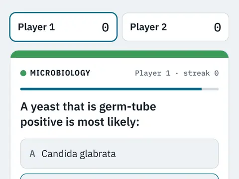

# Bench Rounds

**Clinical lab trivia, solo or pass-and-play.**

▶ **Play:** [https://dougm1966.github.io/1off-1file-games/games/bench-rounds/](https://dougm1966.github.io/1off-1file-games/games/bench-rounds/) · or open [`index.html`](index.html) in any browser

| | |
|---|---|
| Type | Lab |
| Inspired by | clinical lab trivia |
| Built for | phones (portrait, touch); also works with mouse and keyboard |

## How it plays

Multiple-choice trivia for a hospital lab tech: 65 questions across hematology, coagulation, chemistry, microbiology, blood bank, urinalysis and QC. Every answer comes with a short explanation.

## Controls

Tap an answer. In two-player mode, pass the phone when the hand-off screen appears.

## Rules and features

- Solo or two players taking turns, each with their own questions.
- Pick which benches to include and how many questions each.
- Optional 20-second clock; streaks earn bonus points.
- Category colors match tube-cap colors.

## Look and feel

- Type: IBM Plex Sans / Condensed / Mono
- Palette: specimen-label cards; light and dark themes; category colors match tube caps (lavender, light blue, gold, green, pink, yellow, gray)
- Layout: HTML/CSS cards, no canvas

## Technical notes

- One self-contained HTML file: inline CSS and JavaScript, no build step, no libraries. The only external request is Google Fonts, with system-font fallbacks.
- Settings, unlocked levels, best scores and challenges are stored in the browser's `localStorage`, per device.
- Respects phone safe areas (notches) and never scrolls sideways.
- Recreate or remix it with [`PROMPT.md`](PROMPT.md).
