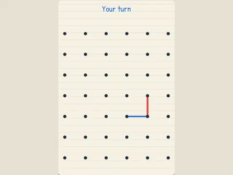

# Box Out

**Dots and Boxes, friend or CPU.**

▶ **Play:** [https://dougm1966.github.io/1off-1file-games/games/box-out/](https://dougm1966.github.io/1off-1file-games/games/box-out/) · or open [`index.html`](index.html) in any browser

| | |
|---|---|
| Type | Two players |
| Inspired by | Dots and Boxes |
| Built for | phones (portrait, touch); also works with mouse and keyboard |

## How it plays

Take turns drawing lines between dots on notebook paper. Close the fourth side of a box to claim it and go again. The hard CPU plays the chain game.

> Take turns drawing lines between dots. Draw the fourth side of a box to claim it, then go again. Most boxes wins. Watch out for handing over long chains.

## Controls

Tap between two dots to draw a line.

## Settings

| Setting | Options |
|---|---|
| Opponent | Pass & play · CPU easy · CPU medium · CPU hard |
| Board | 4×4 · 5×6 · 6×7 |
| Goes first | You / Blue · CPU / Red |
| Highlight 3-sided boxes | On · Off |
| CPU speed | Normal · Fast |

## Challenges

A checklist in the menu that saves on your device:

- [ ] Beat the CPU
- [ ] Beat the hard CPU
- [ ] Close two boxes with one line
- [ ] Take 4+ boxes in one turn
- [ ] Beat the CPU without it scoring a box
- [ ] Win on the 6×7 board
- [ ] Finish a two-player game

## Look and feel

- Type: Patrick Hand for display, system UI for body text
- Palette: background #f6f1e3, text #24303d, accent #2f6fd6
- Layout: logical canvas 360×540, scaled to fit the screen

## Technical notes

- One self-contained HTML file: inline CSS and JavaScript, no build step, no libraries. The only external request is Google Fonts, with system-font fallbacks.
- Settings, unlocked levels, best scores and challenges are stored in the browser's `localStorage`, per device.
- Respects phone safe areas (notches) and never scrolls sideways.
- Recreate or remix it with [`PROMPT.md`](PROMPT.md).
