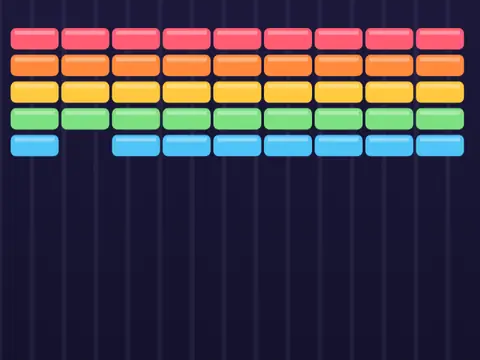

# Brick Bounce

**Breakout-style brick breaker.**

▶ **Play:** [https://dougm1966.github.io/1off-1file-games/games/brick-bounce/](https://dougm1966.github.io/1off-1file-games/games/brick-bounce/) · or open [`index.html`](index.html) in any browser

| | |
|---|---|
| Type | Arcade |
| Inspired by | Breakout |
| Built for | phones (portrait, touch); also works with mouse and keyboard |

## How it plays

Break every brick with the ball across 10 designed levels. Bricks take 1–3 hits; steel bricks need help, bombs clear their neighbours, and falling power-ups give a wide paddle, multi-ball, slow ball, catch or an extra life.

> Break every brick with the ball. Drag anywhere on the board to slide the paddle (the finger never has to touch it) and tap to launch. Catch falling capsules for power-ups.

## Controls

Drag anywhere on the board: the paddle moves by however far your finger moves, so your finger never has to sit on the paddle or cover the ball. Tap to launch. A setting swaps to on-screen ◀ ▶ hold buttons and a LAUNCH button.

## Rules and features

- 10 levels that unlock as you clear them, and 7 challenges.
- A header mute button and pause button; the game pauses itself when you switch apps.

## Settings

| Setting | Options |
|---|---|
| Difficulty | Easy · Normal · Hard |
| Paddle control | Drag (relative) · Buttons |
| Drag sensitivity | Low · Normal · High |
| Lives | 3 · 5 · 7 |
| Power-ups | On · Off |
| Controls side | Buttons right · Buttons left |
| Sound | On · Off |
| Vibration | On · Off |

## Levels

1. First Bricks
2. Checkerboard
3. Pyramid
4. Hard Hats
5. Fortress
6. Pillars
7. Bombs Away
8. Diamond
9. Armor Plating
10. Brick Boss

Levels unlock as you clear them.

## Challenges

A checklist in the menu that saves on your device:

- [ ] Clear a level
- [ ] Catch a Multi-ball capsule
- [ ] Break 8 bricks without touching the paddle
- [ ] Blow up a bomb brick
- [ ] Clear level 5 without losing a ball
- [ ] Score 5000 points in one game
- [ ] Clear Brick Boss (level 10)

## Look and feel

- Type: Righteous for display, system UI for body text
- Palette: background #14122b, text #f4f1ff, accent #ff8a3d
- Layout: logical canvas 360×620, scaled to fit the screen

## Technical notes

- One self-contained HTML file: inline CSS and JavaScript, no build step, no libraries. The only external request is Google Fonts, with system-font fallbacks.
- Settings, unlocked levels, best scores and challenges are stored in the browser's `localStorage`, per device.
- Respects phone safe areas (notches) and never scrolls sideways.
- Recreate or remix it with [`PROMPT.md`](PROMPT.md).
