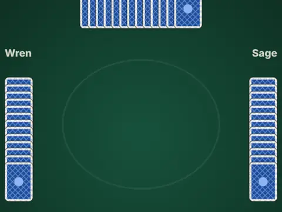

# Card Table

**Hearts, Spades and Euchre vs CPU players.**

▶ **Play:** [https://dougm1966.github.io/1off-1file-games/games/card-table/](https://dougm1966.github.io/1off-1file-games/games/card-table/) · or open [`index.html`](index.html) in any browser

| | |
|---|---|
| Type | Puzzle |
| Inspired by | Hearts, Spades and Euchre |
| Built for | phones (portrait, touch); also works with mouse and keyboard |

## How it plays

Three classic trick-taking card games against three CPU players, with Spades and Euchre played in partnerships.

> Hearts, Spades or Euchre against three CPU players. Your cards fan along the bottom: tap one to raise it, tap it again (or press PLAY) to play it. Dimmed cards can't be played right now.
> Targets (short / normal / long): Hearts 50 / 100 / 150 · Spades 200 / 300 / 500 · Euchre 5 / 10 / 15.

## Controls

Tap a card to raise it, tap it again to play. ◀ ▶ and PLAY buttons select precisely when the hand is crowded. Cards you can't legally play are dimmed.

## Rules and features

- Settings for the game, target score, CPU skill and house rules (passing, blind nil, stick the dealer).
- A header mute button and pause button; the game pauses itself when you switch apps.

## Settings

| Setting | Options |
|---|---|
| Game | Hearts · Spades · Euchre |
| Target score | Short · Normal · Long |
| CPU skill | Easy · Normal · Hard |
| Card back | Blue · Red · Green · Gold |
| Speed | Slow · Normal · Fast |
| Hearts: Jack of Diamonds −10 | Off · On |
| Euchre: stick the dealer | On · Off |
| Controls side | Buttons right · Buttons left |
| Sound | On · Off |
| Vibration | On · Off |

## Challenges

A checklist in the menu that saves on your device:

- [ ] Win a game of Hearts
- [ ] Shoot the moon in Hearts
- [ ] Win a game of Spades
- [ ] Make a nil bid in Spades
- [ ] Win a game of Euchre
- [ ] Euchre the other team (they make it, take under 3)
- [ ] Go alone and take 3+ tricks in Euchre

## Look and feel

- Type: system UI
- Palette: 
- Layout: 

## Technical notes

- One self-contained HTML file: inline CSS and JavaScript, no build step, no libraries. The only external request is Google Fonts, with system-font fallbacks.
- Settings, unlocked levels, best scores and challenges are stored in the browser's `localStorage`, per device.
- Respects phone safe areas (notches) and never scrolls sideways.
- Recreate or remix it with [`PROMPT.md`](PROMPT.md).
