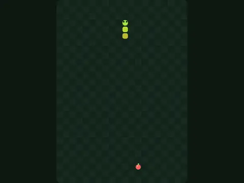

# Coil

**Snake.**

▶ **Play:** [https://dougm1966.github.io/1off-1file-games/games/coil/](https://dougm1966.github.io/1off-1file-games/games/coil/) · or open [`index.html`](index.html) in any browser

| | |
|---|---|
| Type | Arcade |
| Inspired by | Snake |
| Built for | phones (portrait, touch); also works with mouse and keyboard |

## How it plays

Grow the snake by eating apples without hitting walls, rocks or yourself. Classic, Obstacles and Timed modes, three board sizes, and solid or wrap-around walls.

> Eat apples to grow without hitting walls, rocks or yourself. Press the D-pad to turn (roll your thumb between directions; two quick turns are remembered). Golden stars are worth 50 but vanish fast.

## Controls

A D-pad under the board: press a wedge to turn that way, or slide your thumb from wedge to wedge. Up to two quick turns are remembered, and a reversal into yourself is ignored. Hold BOOST to speed up. Swipe on the board is an optional setting.

## Rules and features

- 7 challenges.
- A header mute button and pause button; the game pauses itself when you switch apps.

## Settings

| Setting | Options |
|---|---|
| Mode | Classic · Obstacles · Timed |
| Speed | Slow · Normal · Fast |
| Walls | Solid · Wrap around |
| Board size | Small · Medium · Large |
| Swipe on board (extra) | Off · On |
| Controls side | Buttons right · Buttons left |
| Sound | On · Off |
| Vibration | On · Off |

## Challenges

A checklist in the menu that saves on your device:

- [ ] Grow to length 20
- [ ] Grow to length 40
- [ ] Eat a golden star
- [ ] Buffer two quick turns in a row
- [ ] Eat 10 apples with wrap-around walls
- [ ] Eat 8 apples in Obstacles mode
- [ ] Eat 15 apples in Timed mode

## Look and feel

- Type: Silkscreen for display, system UI for body text
- Palette: background #0f1a12, text #e8f5e1, accent #b8f05a
- Layout: logical canvas 360×504, scaled to fit the screen

## Technical notes

- One self-contained HTML file: inline CSS and JavaScript, no build step, no libraries. The only external request is Google Fonts, with system-font fallbacks.
- Settings, unlocked levels, best scores and challenges are stored in the browser's `localStorage`, per device.
- Respects phone safe areas (notches) and never scrolls sideways.
- Recreate or remix it with [`PROMPT.md`](PROMPT.md).
