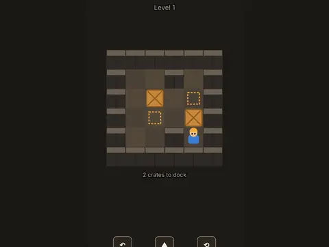

# Crate Crew

**Sokoban crate-pushing puzzles.**

▶ **Play:** [https://dougm1966.github.io/1off-1file-games/games/crate-crew/](https://dougm1966.github.io/1off-1file-games/games/crate-crew/) · or open [`index.html`](index.html) in any browser

| | |
|---|---|
| Type | Puzzle |
| Inspired by | Sokoban |
| Built for | phones (portrait, touch); also works with mouse and keyboard |

## How it plays

Push every crate onto a dock. You can only push, never pull, one crate at a time. Fifteen levels, all guaranteed solvable; levels 1–9 show the shortest possible solution.

> Push every crate onto a dock. You can only push, never pull, and only one crate at a time. Plan ahead so nothing gets stuck in a corner.

## Controls

Swipe or use the on-screen pad to walk; Undo and Restart buttons. Arrow keys and Z also work.

## Settings

| Setting | Options |
|---|---|
| Controls | Swipe + pad · Swipe only · Pad only |
| Undo | On · Off |
| Look | Warehouse · Lab |

## Levels

1. Level 1 · 2 crates · best 8 moves
2. Level 2 · 2 crates · best 14 moves
3. Level 3 · 2 crates · best 25 moves
4. Level 4 · 3 crates · best 24 moves
5. Level 5 · 3 crates · best 29 moves
6. Level 6 · 3 crates · best 35 moves
7. Level 7 · 3 crates · best 41 moves
8. Level 8 · 3 crates · best 49 moves
9. Level 9 · 4 crates · best 50 moves
10. Level 10 · 4 crates
11. Level 11 · 4 crates
12. Level 12 · 4 crates
13. Level 13 · 5 crates
14. Level 14 · 5 crates
15. Level 15 · 5 crates

Levels unlock as you clear them.

## Challenges

A checklist in the menu that saves on your device:

- [ ] Solve a level in the shortest possible moves
- [ ] Solve a level without undo
- [ ] Clear level 5
- [ ] Clear level 10
- [ ] Clear all 15 levels

## Look and feel

- Type: Russo One for display, system UI for body text
- Palette: background #1d1a16, text #f4ede1, accent #f2a93b
- Layout: logical canvas 360×560, scaled to fit the screen

## Technical notes

- One self-contained HTML file: inline CSS and JavaScript, no build step, no libraries. The only external request is Google Fonts, with system-font fallbacks.
- Settings, unlocked levels, best scores and challenges are stored in the browser's `localStorage`, per device.
- Respects phone safe areas (notches) and never scrolls sideways.
- Recreate or remix it with [`PROMPT.md`](PROMPT.md).
