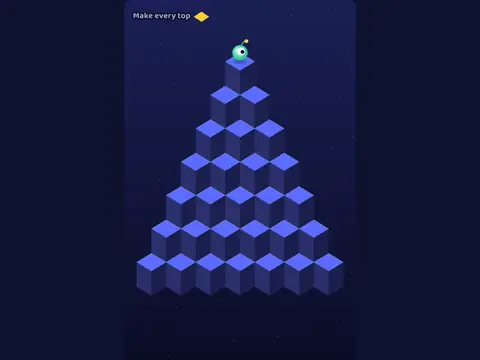

# Cube Hop

**Pyramid cube-hopping.**

▶ **Play:** [https://dougm1966.github.io/1off-1file-games/games/cube-hop/](https://dougm1966.github.io/1off-1file-games/games/cube-hop/) · or open [`index.html`](index.html) in any browser

| | |
|---|---|
| Type | Arcade |
| Inspired by | Q*bert |
| Built for | phones (portrait, touch); also works with mouse and keyboard |

## How it plays

Hop down a pyramid of cubes changing their colour while bouncing balls and a chaser come after you. Later levels flip cubes back when you land again. Escape discs carry you to the top.

> Hop on every cube until its top matches the goal colour. Use the four diamond buttons under the board: each arrow points the way you hop (keys Q W A S). You can also tap a glowing cube. Dodge red balls and the burr, and don't hop off the edge. Hop onto a spinning disc to ride it to the top.

## Controls

Four diagonal buttons (↖ ↗ ↙ ↘) under the board, pointing the same way the hops go on the pyramid. You can also tap one of the highlighted neighbouring cubes. Keys Q W A S or arrows.

## Rules and features

- 10 levels that unlock, and 7 challenges.
- A header mute button and pause button; the game pauses itself when you switch apps.

## Settings

| Setting | Options |
|---|---|
| Difficulty | Easy · Normal · Hard |
| Lives | 3 · 5 · 7 |
| Escape discs | On · Off |
| Tap a cube to hop | On · Off |
| Hold button to keep hopping | Off · On |
| Glow on hop targets | On · Off |
| Sound | On · Off |
| Vibration | On · Off |

## Levels

1. First Hops
2. Rolling Reds
3. Burr Alert
4. Double Colour
5. Two-Tone Trouble
6. Flip Flop
7. Flip and Flee
8. Burr Pair
9. Fast Flip
10. Summit Rush

Levels unlock as you clear them.

## Challenges

A checklist in the menu that saves on your device:

- [ ] Clear Burr Alert (level 3)
- [ ] Clear Flip Flop (level 6)
- [ ] Clear Summit Rush (level 10)
- [ ] Ride an escape disc
- [ ] Sweep a burr off with a disc
- [ ] Clear a level without losing a life
- [ ] Score 5000 in one game

## Look and feel

- Type: Baloo 2 for display, system UI for body text
- Palette: background #101433, text #f1f3ff, accent #ffcf33
- Layout: logical canvas 360×560, scaled to fit the screen

## Technical notes

- One self-contained HTML file: inline CSS and JavaScript, no build step, no libraries. The only external request is Google Fonts, with system-font fallbacks.
- Settings, unlocked levels, best scores and challenges are stored in the browser's `localStorage`, per device.
- Respects phone safe areas (notches) and never scrolls sideways.
- Recreate or remix it with [`PROMPT.md`](PROMPT.md).
