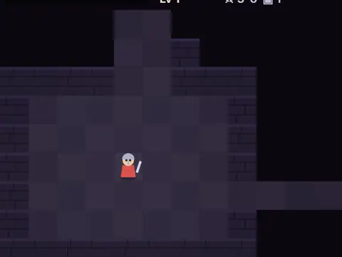

# Deep Delve

**Turn-based dungeon crawler with a daily dungeon.**

▶ **Play:** [https://dougm1966.github.io/1off-1file-games/games/deep-delve/](https://dougm1966.github.io/1off-1file-games/games/deep-delve/) · or open [`index.html`](index.html) in any browser

| | |
|---|---|
| Type | Arcade |
| Inspired by | roguelike dungeon crawlers |
| Built for | phones (portrait, touch); also works with mouse and keyboard |

## How it plays

A turn-based dungeon crawl through 10 generated floors with fog of war, monsters, items and permadeath. Daily dungeon mode gives everyone the same layout that day.

> Delve ten floors, find the stairs on each and defeat the Hollow King. Use the D-pad to move and attack, or tap a floor tile to walk there. Death is permanent.
> Daily dungeon today: seed 20261027. Best floor 0.

## Controls

A D-pad moves and attacks one square per press (hold to repeat). Tap a visible floor tile to walk there. WAIT, USE and STAIRS buttons.

## Rules and features

- Three classes and three difficulties.
- A header mute button and pause button; the game pauses itself when you switch apps.

## Settings

| Setting | Options |
|---|---|
| Class | Warrior · Rogue · Mage |
| Difficulty | Easy · Normal · Hard |
| Dungeon | Random · Daily |
| Auto-pickup | On · Off |
| Tap floor to travel | On · Off |
| Controls side | Buttons right · Buttons left |
| Sound | On · Off |
| Vibration | On · Off |

## Levels

1. The Cellars
2. Rat Warrens
3. Mossy Halls
4. Bone Gallery
5. Slime Pits
6. The Barracks
7. Cursed Library
8. Ogre Den
9. Shadow Vault
10. The Hollow Throne

Levels unlock as you clear them.

## Challenges

A checklist in the menu that saves on your device:

- [ ] Reach floor 3
- [ ] Reach floor 5
- [ ] Slay 25 enemies in one run
- [ ] Collect 250 gold in one run
- [ ] Reach character level 8
- [ ] Reach floor 3 in the Daily dungeon
- [ ] Defeat the Hollow King

## Look and feel

- Type: system UI
- Palette: 
- Layout: 

## Technical notes

- One self-contained HTML file: inline CSS and JavaScript, no build step, no libraries. The only external request is Google Fonts, with system-font fallbacks.
- Settings, unlocked levels, best scores and challenges are stored in the browser's `localStorage`, per device.
- Respects phone safe areas (notches) and never scrolls sideways.
- Recreate or remix it with [`PROMPT.md`](PROMPT.md).
