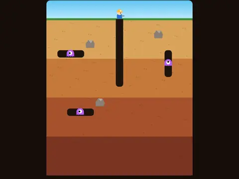

# Deep Dig

**Tunnel digging and monster popping.**

▶ **Play:** [https://dougm1966.github.io/1off-1file-games/games/deep-dig/](https://dougm1966.github.io/1off-1file-games/games/deep-dig/) · or open [`index.html`](index.html) in any browser

| | |
|---|---|
| Type | Arcade |
| Inspired by | Dig Dug |
| Built for | phones (portrait, touch); also works with mouse and keyboard |

## How it plays

Tunnel through the earth and pump up monsters until they pop, or drop rocks on them. Fire-breathing lizards appear on later levels.

> Dig tunnels with the D-pad on one side and pop every monster. Face one and hold PUMP on the other side to inflate it until it bursts, or drop a rock on it for a big bonus. Move away to let go.

## Controls

A D-pad on the left (hold to keep moving, slide to change direction) and a big PUMP button on the right; move and pump together. Hold the D-pad away for a moment to let go of a monster.

## Rules and features

- 10 levels that unlock, and 7 challenges.
- A header mute button and pause button; the game pauses itself when you switch apps.

## Settings

| Setting | Options |
|---|---|
| Difficulty | Easy · Normal · Hard |
| Lives | 3 · 5 · 7 |
| Pump | Hold to pump · Tap each pump |
| Lizards breathe fire | On · Off |
| Controls side | Buttons right · Buttons left |
| Sound | On · Off |
| Vibration | On · Off |

## Levels

1. Topsoil
2. Clay Pit
3. Rockfall
4. Fire Lizards
5. Deep Cut
6. Crowded Cave
7. Boulder Alley
8. Magma Run
9. Bedrock
10. Core Breaker

Levels unlock as you clear them.

## Challenges

A checklist in the menu that saves on your device:

- [ ] Pop a monster
- [ ] Pop 5 monsters in one game
- [ ] Crush 2 monsters with one rock
- [ ] Pop a monster in the deepest layer
- [ ] Clear Rockfall (level 3)
- [ ] Clear a level without losing a life
- [ ] Clear Core Breaker (level 10)

## Look and feel

- Type: Luckiest Guy for display, system UI for body text
- Palette: background #170f0a, text #fff3df, accent #ffb92e
- Layout: logical canvas 364×442, scaled to fit the screen

## Technical notes

- One self-contained HTML file: inline CSS and JavaScript, no build step, no libraries. The only external request is Google Fonts, with system-font fallbacks.
- Settings, unlocked levels, best scores and challenges are stored in the browser's `localStorage`, per device.
- Respects phone safe areas (notches) and never scrolls sideways.
- Recreate or remix it with [`PROMPT.md`](PROMPT.md).
