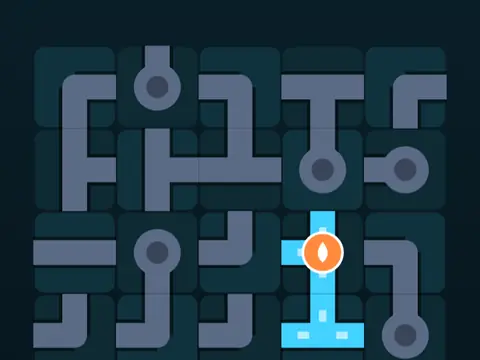

# Flow Lines

**Rotate pipes to connect the flow.**

▶ **Play:** [https://dougm1966.github.io/1off-1file-games/games/flow-lines/](https://dougm1966.github.io/1off-1file-games/games/flow-lines/) · or open [`index.html`](index.html) in any browser

| | |
|---|---|
| Type | Puzzle |
| Inspired by | pipe-connection puzzles |
| Built for | phones (portrait, touch); also works with mouse and keyboard |

## How it plays

Rotate pipe tiles until every pipe connects back to the source. Classic, Timed flow (race the liquid) and a Daily puzzle, from 5×5 up to 9×11.

> Tap a tile to turn it a quarter turn, and hold a tile to lock it. Connect every pipe back to the orange source so the whole network lights up. In Timed flow, finish before the liquid arrives.

## Controls

Tap a tile to rotate it 90°; long-press to lock it. Undo, Reset and Hint buttons under the board. Connected pipes light up.

## Rules and features

- 11 size tiers that unlock, wrap-around edges and a colour-blind-friendly palette.
- A header mute button and pause button; the game pauses itself when you switch apps.

## Settings

| Setting | Options |
|---|---|
| Mode | Classic · Timed flow · Daily |
| Board size | Smaller · Tier size · Larger |
| Wrap-around edges | Off · On |
| Colours | Standard · Colour-blind friendly |
| Tap turns | Clockwise · Counter-clockwise |
| Flow animation | On · Off |
| Sound | On · Off |
| Vibration | On · Off |

## Levels

1. Trickle · 5×5
2. Brook · 5×6
3. Stream · 6×6
4. Creek · 6×7
5. River · 7×7
6. Canal · 7×8
7. Delta · 8×8
8. Rapids · 8×9
9. Torrent · 9×9
10. Cascade · 9×10
11. Deluge · 9×11

Levels unlock as you clear them.

## Challenges

A checklist in the menu that saves on your device:

- [ ] Solve any puzzle
- [ ] Solve in par moves or fewer
- [ ] Solve a 7×7 or larger board
- [ ] Solve a puzzle with wrap-around on
- [ ] Win a Timed flow puzzle
- [ ] Solve the daily puzzle
- [ ] Lock a tile with a long press

## Look and feel

- Type: system UI
- Palette: 
- Layout: 

## Technical notes

- One self-contained HTML file: inline CSS and JavaScript, no build step, no libraries. The only external request is Google Fonts, with system-font fallbacks.
- Settings, unlocked levels, best scores and challenges are stored in the browser's `localStorage`, per device.
- Respects phone safe areas (notches) and never scrolls sideways.
- Recreate or remix it with [`PROMPT.md`](PROMPT.md).
