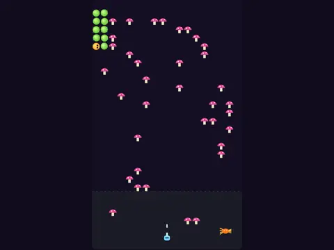

# Garden Crawl

**Centipede-style shooter.**

▶ **Play:** [https://dougm1966.github.io/1off-1file-games/games/garden-crawl/](https://dougm1966.github.io/1off-1file-games/games/garden-crawl/) · or open [`index.html`](index.html) in any browser

| | |
|---|---|
| Type | Arcade |
| Inspired by | Centipede |
| Built for | phones (portrait, touch); also works with mouse and keyboard |

## How it plays

A garden gnome holds off a centipede winding down through mushrooms, plus spiders and scouts, over 10 waves. Shot segments split the centipede in two.

> A centipede winds down through your mushroom patch. Put a finger anywhere on the board and drag: the gnome slides the same way inside the outlined zone, and sprays while your finger is down. Each hit segment sprouts a mushroom and splits the train.

## Controls

Drag anywhere on the board: the gnome moves by however far your finger moves, inside its outlined zone, and fires automatically while a finger is down. A setting gives a thumb stick plus FIRE button instead.

## Rules and features

- 10 waves that unlock, and 7 challenges.
- A header mute button and pause button; the game pauses itself when you switch apps.

## Settings

| Setting | Options |
|---|---|
| Controls | Drag on board · Stick + Fire |
| Difficulty | Easy · Normal · Hard |
| Gnomes | 3 · 5 |
| Drag speed | Slow · Normal · Fast |
| Controls side | Buttons right · Buttons left |
| Sound | On · Off |
| Vibration | On · Off |

## Levels

1. Dewy Dawn
2. Clover Patch
3. Slug Trail
4. Spider Web
5. Toadstool Ring
6. Bramble Row
7. Midnight Mulch
8. Thorn Hedge
9. Mushroom Maze
10. The Great Crawl

Levels unlock as you clear them.

## Challenges

A checklist in the menu that saves on your device:

- [ ] Shoot a centipede head
- [ ] Split the centipede into 3 pieces
- [ ] Shoot a spider up close (900 points)
- [ ] Destroy 20 mushrooms in one game
- [ ] Clear a wave without losing a gnome
- [ ] Clear Toadstool Ring (wave 5)
- [ ] Clear The Great Crawl

## Look and feel

- Type: Fredoka for display, system UI for body text
- Palette: background #120d1f, text #f6f0ff, accent #9cff57
- Layout: logical canvas 360×600, scaled to fit the screen

## Technical notes

- One self-contained HTML file: inline CSS and JavaScript, no build step, no libraries. The only external request is Google Fonts, with system-font fallbacks.
- Settings, unlocked levels, best scores and challenges are stored in the browser's `localStorage`, per device.
- Respects phone safe areas (notches) and never scrolls sideways.
- Recreate or remix it with [`PROMPT.md`](PROMPT.md).
