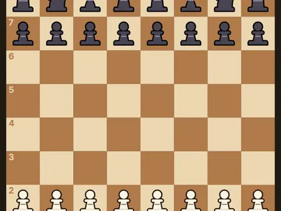

# Grand Master

**Chess vs a 5-level CPU or a friend.**

▶ **Play:** [https://dougm1966.github.io/1off-1file-games/games/grand-master/](https://dougm1966.github.io/1off-1file-games/games/grand-master/) · or open [`index.html`](index.html) in any browser

| | |
|---|---|
| Type | Two players |
| Inspired by | chess |
| Built for | phones (portrait, touch); also works with mouse and keyboard |

## How it plays

Full chess against a CPU with five strengths, or pass-and-play: castling, en passant, promotion, and every draw rule.

> Classic chess. Tap a piece, then tap a dot to move it, or drag a piece: it floats above your finger so you can see where it lands. Buttons under the board: undo, hint, flip and move list.

## Controls

Tap a piece to see its legal moves, then tap a square; or drag the piece, which is drawn above your finger. Undo, hint and resign buttons.

## Rules and features

- Optional clock, legal-move dots, last-move highlight and a pass card for two players.
- A header mute button and pause button; the game pauses itself when you switch apps.

## Settings

| Setting | Options |
|---|---|
| Opponent | CPU · Pass & play |
| CPU strength | 1 · 2 · 3 · 4 · 5 |
| You play | White · Black · Random |
| Board | Walnut · Slate · Forest · Rose |
| Show legal moves | On · Off |
| Clock (per side) | None · 5 min · 10 min |
| Rotate board for Player 2 | Off · On |
| “Pass the phone” card | On · Off |
| Sound | On · Off |
| Vibration | On · Off |

## Challenges

A checklist in the menu that saves on your device:

- [ ] Beat the CPU
- [ ] Beat Club strength (3) or higher
- [ ] Beat Strong strength (4) or higher
- [ ] Checkmate the CPU in 30 moves or fewer
- [ ] Win without using Undo or Hint
- [ ] Castle
- [ ] Capture en passant
- [ ] Promote a pawn

## Look and feel

- Type: system UI
- Palette: 
- Layout: 

## Technical notes

- One self-contained HTML file: inline CSS and JavaScript, no build step, no libraries. The only external request is Google Fonts, with system-font fallbacks.
- Settings, unlocked levels, best scores and challenges are stored in the browser's `localStorage`, per device.
- Respects phone safe areas (notches) and never scrolls sideways.
- Recreate or remix it with [`PROMPT.md`](PROMPT.md).
