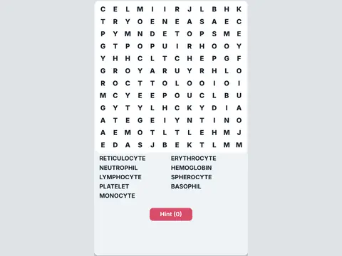

# Lab Hunt

**Lab-themed word search.**

▶ **Play:** [https://dougm1966.github.io/1off-1file-games/games/lab-hunt/](https://dougm1966.github.io/1off-1file-games/games/lab-hunt/) · or open [`index.html`](index.html) in any browser

| | |
|---|---|
| Type | Lab |
| Inspired by | word search |
| Built for | phones (portrait, touch); also works with mouse and keyboard |

## How it plays

Word search with lab and medical word lists; find every hidden word in the grid.

> Find every lab word hidden in the grid. Each theme you finish unlocks the next.

## Controls

Drag across letters in a straight line to select a word.

## Settings

| Setting | Options |
|---|---|
| Grid | 10×10 · across & down · 12×12 · + diagonals · 14×14 · + backwards |
| Timer | On · Off |

## Levels

1. Hematology
2. Lab gear
3. Chemistry
4. Microbiology
5. Coagulation
6. Urinalysis
7. Blood bank
8. Lab life

Levels unlock as you clear them.

## Challenges

A checklist in the menu that saves on your device:

- [ ] Finish a theme
- [ ] Finish without hints
- [ ] Finish in under 2 minutes
- [ ] Find a backwards word
- [ ] Finish a 14×14 grid
- [ ] Finish all 8 themes

## Look and feel

- Type: Archivo Black for display, system UI for body text
- Palette: background #eef3f6, text #16232e, accent #d94c6a
- Layout: logical canvas 360×600, scaled to fit the screen

## Technical notes

- One self-contained HTML file: inline CSS and JavaScript, no build step, no libraries. The only external request is Google Fonts, with system-font fallbacks.
- Settings, unlocked levels, best scores and challenges are stored in the browser's `localStorage`, per device.
- Respects phone safe areas (notches) and never scrolls sideways.
- Recreate or remix it with [`PROMPT.md`](PROMPT.md).
