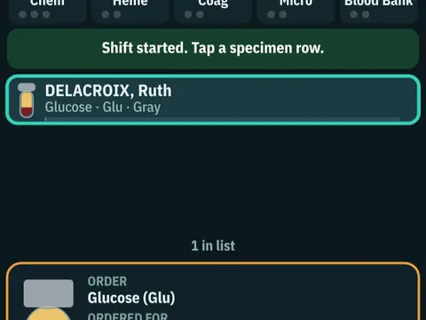

# Lab Shift

**Clinical-lab shift simulator.**

▶ **Play:** [https://dougm1966.github.io/1off-1file-games/games/lab-shift/](https://dougm1966.github.io/1off-1file-games/games/lab-shift/) · or open [`index.html`](index.html) in any browser

| | |
|---|---|
| Type | Lab |
| Inspired by | a hospital clinical-lab shift |
| Built for | phones (portrait, touch); also works with mouse and keyboard |

## How it plays

Work a lab shift: route arriving specimens to the right department or reject them for the right reason, then release results, call critical values and rerun delta-check failures. Ten shifts, up to a mass-casualty night.

> You run receiving at a hospital lab. Tap a specimen row to inspect it, then use the six buttons under the board: send it to the right department, or reject it with the right reason. Later, release results, CALL critical values, and rerun delta-check failures. Fast and accurate wins.

## Controls

Tap a specimen to inspect it, then tap one of the big action buttons under the board. A REF button opens tube-top, critical-value and rejection references.

## Rules and features

- Critical values and rules follow common references; local lab policy can differ.
- A header mute button and pause button; the game pauses itself when you switch apps.

## Settings

| Setting | Options |
|---|---|
| Difficulty | Trainee · Tech · Senior |
| Shift length | Short 4h · Standard 8h · Long 12h |
| Hints | Off · Show rules · Full guide |
| Department focus | All · Chem · Heme · Coag · Micro · Blood Bank |
| Sound | On · Off |
| Vibration | On · Off |

## Levels

1. Day 1: Orientation
2. Day: Morning Draw
3. Evening: Clinic Backlog
4. Night: Quiet Hours
5. Day: ER Surge
6. Evening: Transfusion Night
7. Night: ICU Rounds
8. Day: Outbreak Day
9. Night: Skeleton Crew
10. MASS CASUALTY

Levels unlock as you clear them.

## Challenges

A checklist in the menu that saves on your device:

- [ ] Reject a hemolyzed specimen
- [ ] Catch a mislabeled tube
- [ ] Call a critical within 10 minutes of the result
- [ ] Rerun a delta-check failure
- [ ] Release a STAT within 15 minutes of arrival
- [ ] Finish a shift with no errors (8+ decisions)
- [ ] Pass the Mass Casualty shift

## Look and feel

- Type: system UI
- Palette: 
- Layout: 

## Technical notes

- One self-contained HTML file: inline CSS and JavaScript, no build step, no libraries. The only external request is Google Fonts, with system-font fallbacks.
- Settings, unlocked levels, best scores and challenges are stored in the browser's `localStorage`, per device.
- Respects phone safe areas (notches) and never scrolls sideways.
- Recreate or remix it with [`PROMPT.md`](PROMPT.md).
