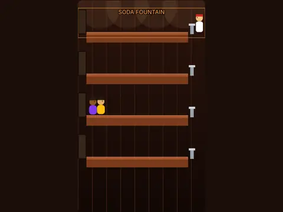

# Last Call

**Tapper-style bar rush.**

▶ **Play:** [https://dougm1966.github.io/1off-1file-games/games/last-call/](https://dougm1966.github.io/1off-1file-games/games/last-call/) · or open [`index.html`](index.html) in any browser

| | |
|---|---|
| Type | Arcade |
| Inspired by | Tapper |
| Built for | phones (portrait, touch); also works with mouse and keyboard |

## How it plays

Customers walk up four bars. Slide each a drink before they reach you, catch the empty mugs they send back and grab tips. Don't let a drink or mug fall off the end.

> Customers walk up the bars. Slide them a drink before they reach you. Catch the empty mugs they send back. Don't let a drink or a mug fall off the end.

## Controls

Tap a bar to step behind it and slide a drink down it; tap coins to collect tips.

## Settings

| Setting | Options |
|---|---|
| Pace | Relaxed · Standard · Rush hour |
| Lives | 3 · 5 |
| Shop | Soda fountain · Coffee bar |

## Levels

1. Round 1 · serve 8
2. Round 2 · serve 11
3. Round 3 · serve 14
4. Round 4 · serve 17
5. Round 5 · serve 20
6. Round 6 · serve 23
7. Round 7 · serve 26
8. Round 8 · serve 29
9. Round 9 · serve 32
10. Round 10 · serve 35

Levels unlock as you clear them.

## Challenges

A checklist in the menu that saves on your device:

- [ ] Finish a round without losing a life
- [ ] Finish a round without breaking a glass
- [ ] Send 4 customers out the door within 5 seconds
- [ ] Collect 10 tips in total
- [ ] Clear round 5
- [ ] Clear round 10

## Look and feel

- Type: Shrikhand for display, system UI for body text
- Palette: background #1d0f0b, text #fff1e0, accent #ff9d3d
- Layout: logical canvas 360×600, scaled to fit the screen

## Technical notes

- One self-contained HTML file: inline CSS and JavaScript, no build step, no libraries. The only external request is Google Fonts, with system-font fallbacks.
- Settings, unlocked levels, best scores and challenges are stored in the browser's `localStorage`, per device.
- Respects phone safe areas (notches) and never scrolls sideways.
- Recreate or remix it with [`PROMPT.md`](PROMPT.md).
