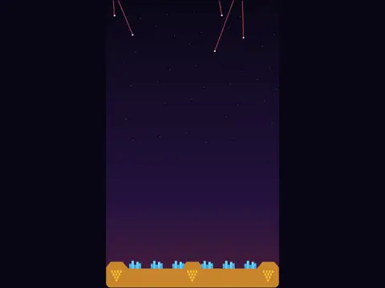

# Last Line

**Missile Command-style city defense.**

▶ **Play:** [https://dougm1966.github.io/1off-1file-games/games/last-line/](https://dougm1966.github.io/1off-1file-games/games/last-line/) · or open [`index.html`](index.html) in any browser

| | |
|---|---|
| Type | Arcade |
| Inspired by | Missile Command |
| Built for | phones (portrait, touch); also works with mouse and keyboard |

## How it plays

Defend six cities from falling missiles, splitters and bombers across 10 waves, with limited interceptors at three bases.

> Missiles are falling on your six cities. Tap the exact spot in the sky where you want a counter-missile to burst. Blasts take a moment to grow, so lead your shots.

## Controls

Tap the exact point in the sky where you want an interceptor to burst; a crosshair marks it and nothing is offset. Several fingers can tap at once. A 'Selected base' setting adds three base buttons to choose which base fires.

## Rules and features

- 10 waves that unlock, and 7 challenges.
- A header mute button and pause button; the game pauses itself when you switch apps.

## Settings

| Setting | Options |
|---|---|
| Launch from | Nearest base · Selected base |
| Difficulty | Easy · Normal · Hard |
| Ammo per base | 8 · 10 · 14 |
| Blast size | Normal · Large |
| Sound | On · Off |
| Vibration | On · Off |

## Levels

1. First Strike
2. Sky Rain
3. Split Decision
4. Bomber Run
5. Night Raid
6. Swarm
7. Meteor Shower
8. Double Bombers
9. Firestorm
10. The Last Line

Levels unlock as you clear them.

## Challenges

A checklist in the menu that saves on your device:

- [ ] Destroy 4 missiles with one interceptor
- [ ] Shoot down a bomber
- [ ] Clear a wave without losing a city or base
- [ ] Clear a wave with 15+ ammo left
- [ ] Clear Night Raid (wave 5)
- [ ] Score 5000 in one game
- [ ] Clear The Last Line (wave 10)

## Look and feel

- Type: Teko for display, system UI for body text
- Palette: background #0a0716, text #fff1e8, accent #ffcc33
- Layout: logical canvas 360×600, scaled to fit the screen

## Technical notes

- One self-contained HTML file: inline CSS and JavaScript, no build step, no libraries. The only external request is Google Fonts, with system-font fallbacks.
- Settings, unlocked levels, best scores and challenges are stored in the browser's `localStorage`, per device.
- Respects phone safe areas (notches) and never scrolls sideways.
- Recreate or remix it with [`PROMPT.md`](PROMPT.md).
