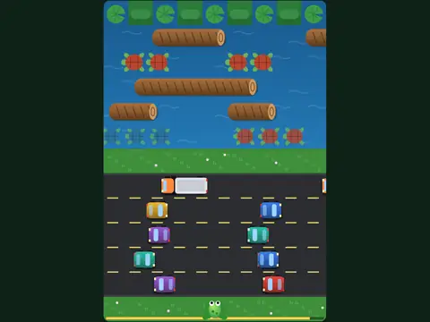

# Lily Pad Dash

**Frogger-style road and river crossing.**

▶ **Play:** [https://dougm1966.github.io/1off-1file-games/games/lily-pad-dash/](https://dougm1966.github.io/1off-1file-games/games/lily-pad-dash/) · or open [`index.html`](index.html) in any browser

| | |
|---|---|
| Type | Arcade |
| Inspired by | Frogger |
| Built for | phones (portrait, touch); also works with mouse and keyboard |

## How it plays

Hop a frog across five lanes of traffic and a river of logs and diving turtles into five lily-pad bays. Fill every bay to clear the level; speeds rise each level.

## Controls

Tap ahead of the frog to hop forward, behind it to hop back, and beside it to hop left or right. Arrow keys also work.

## Rules and features

- Three lives, a 30-second timer per frog, points for every new row reached and bonus points for time left.
- Turtles periodically dive; standing on a submerged turtle drops you in the river.

## Look and feel

- Type: Lilita One + Nunito
- Palette: deep green (#10241a) with a warm yellow accent (#ffd34d); bright cartoon cars, logs, red-shelled turtles
- Layout: canvas 360×520 on a 40px grid

## Technical notes

- One self-contained HTML file: inline CSS and JavaScript, no build step, no libraries. The only external request is Google Fonts, with system-font fallbacks.
- Settings, unlocked levels, best scores and challenges are stored in the browser's `localStorage`, per device.
- Respects phone safe areas (notches) and never scrolls sideways.
- Recreate or remix it with [`PROMPT.md`](PROMPT.md).
