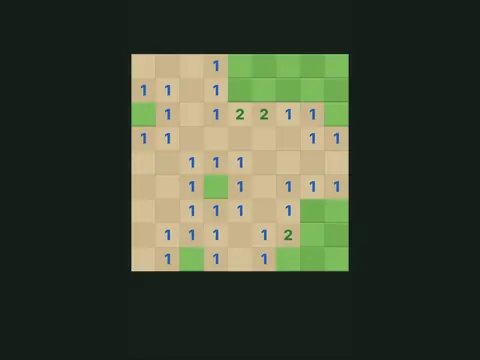

# Mine Field

**Minesweeper.**

▶ **Play:** [https://dougm1966.github.io/1off-1file-games/games/mine-field/](https://dougm1966.github.io/1off-1file-games/games/mine-field/) · or open [`index.html`](index.html) in any browser

| | |
|---|---|
| Type | Puzzle |
| Inspired by | Minesweeper |
| Built for | phones (portrait, touch); also works with mouse and keyboard |

## How it plays

Clear every square that isn't a mine; numbers show how many mines touch each square.

> Clear every square that isn't a mine. Each number tells you how many mines touch that square.

## Controls

Tap to dig, long-press (or Flag mode) to flag, tap a number to clear around it (chording).

## Settings

| Setting | Options |
|---|---|
| Field | Easy 9×9 · Medium 12×16 · Hard 16×24 |
| First tap | Opens an area · Safe square only |
| Question marks | Off · On |

## Challenges

A checklist in the menu that saves on your device:

- [ ] Clear an Easy field
- [ ] Clear Easy in under 60 seconds
- [ ] Clear a Medium field
- [ ] Clear a Hard field
- [ ] Win without placing a single flag
- [ ] Use 10 number-taps (chords) in one game

## Look and feel

- Type: Space Grotesk for display, system UI for body text
- Palette: background #16201a, text #eef5ea, accent #f2c14e
- Layout: logical canvas 360×580, scaled to fit the screen

## Technical notes

- One self-contained HTML file: inline CSS and JavaScript, no build step, no libraries. The only external request is Google Fonts, with system-font fallbacks.
- Settings, unlocked levels, best scores and challenges are stored in the browser's `localStorage`, per device.
- Respects phone safe areas (notches) and never scrolls sideways.
- Recreate or remix it with [`PROMPT.md`](PROMPT.md).
