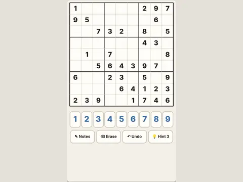

# Nine Squares

**Sudoku with generated puzzles.**

▶ **Play:** [https://dougm1966.github.io/1off-1file-games/games/nine-squares/](https://dougm1966.github.io/1off-1file-games/games/nine-squares/) · or open [`index.html`](index.html) in any browser

| | |
|---|---|
| Type | Puzzle |
| Inspired by | Sudoku |
| Built for | phones (portrait, touch); also works with mouse and keyboard |

## How it plays

Freshly generated Sudoku puzzles with exactly one solution, in four difficulties, with pencil notes, hints and undo.

> Fill the grid so every row, column and 3×3 box has 1 through 9 once. Every puzzle is freshly generated and has exactly one solution.

## Controls

Tap a square, then a number. Notes mode adds pencil marks; Erase, Undo and Hint buttons.

## Settings

| Setting | Options |
|---|---|
| Difficulty | Easy · Medium · Hard · Expert |
| Show wrong numbers | Red · Hidden |
| Mistake limit | 3 strikes · Off |
| Hints | None · 3 · 9 |
| Clear notes automatically | On · Off |

## Challenges

A checklist in the menu that saves on your device:

- [ ] Solve an Easy
- [ ] Solve a Medium
- [ ] Solve a Hard
- [ ] Solve an Expert
- [ ] Solve with zero mistakes
- [ ] Solve without hints
- [ ] Solve a Medium in under 10 minutes

## Look and feel

- Type: Fraunces for display, system UI for body text
- Palette: background #f4f0e8, text #22201c, accent #3b6ea8
- Layout: logical canvas 360×600, scaled to fit the screen

## Technical notes

- One self-contained HTML file: inline CSS and JavaScript, no build step, no libraries. The only external request is Google Fonts, with system-font fallbacks.
- Settings, unlocked levels, best scores and challenges are stored in the browser's `localStorage`, per device.
- Respects phone safe areas (notches) and never scrolls sideways.
- Recreate or remix it with [`PROMPT.md`](PROMPT.md).
