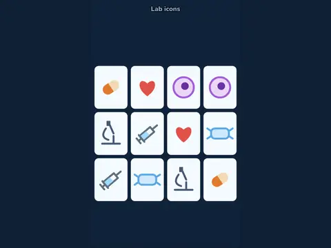

# Pair Up

**Memory match with lab decks, solo or two players.**

▶ **Play:** [https://dougm1966.github.io/1off-1file-games/games/pair-up/](https://dougm1966.github.io/1off-1file-games/games/pair-up/) · or open [`index.html`](index.html) in any browser

| | |
|---|---|
| Type | Lab |
| Inspired by | memory match / concentration |
| Built for | phones (portrait, touch); also works with mouse and keyboard |

## How it plays

Flip two cards at a time to find pairs. Besides a lab-icon picture deck, three brainy decks match a term to its answer: tube color ↔ test, organism ↔ Gram stain, analyte ↔ normal range.

> Flip two cards at a time and find the pairs. The brainy decks match a term to its answer instead of identical pictures.

## Controls

Tap two cards to flip them.

## Settings

| Setting | Options |
|---|---|
| Deck | Lab icons · Tube ↔ test · Bug ↔ Gram · Normal values |
| Players | Solo · Two players |
| Peek at the start | Off · 2 seconds |
| Flip-back speed | Slow · Normal · Fast |

## Levels

1. Warm-up 4×3
2. Classic 4×4
3. Big 4×5
4. Huge 5×6

Levels unlock as you clear them.

## Challenges

A checklist in the menu that saves on your device:

- [ ] Finish with at most 2 extra moves
- [ ] Finish without a single miss
- [ ] Match 4 pairs in a row
- [ ] Clear the 4×4 in under 45 seconds
- [ ] Clear the 5×6 board
- [ ] Clear a level with a brainy deck
- [ ] Finish a two-player game

## Look and feel

- Type: Nunito for display, system UI for body text
- Palette: background #10233a, text #eef5fb, accent #4fd1c5
- Layout: logical canvas 360×600, scaled to fit the screen

## Technical notes

- One self-contained HTML file: inline CSS and JavaScript, no build step, no libraries. The only external request is Google Fonts, with system-font fallbacks.
- Settings, unlocked levels, best scores and challenges are stored in the browser's `localStorage`, per device.
- Respects phone safe areas (notches) and never scrolls sideways.
- Recreate or remix it with [`PROMPT.md`](PROMPT.md).
