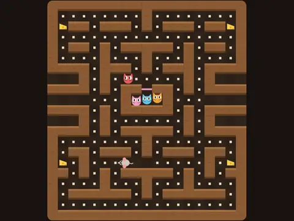

# Pantry Raid

**Maze chase: mouse vs cats.**

▶ **Play:** [https://dougm1966.github.io/1off-1file-games/games/pantry-raid/](https://dougm1966.github.io/1off-1file-games/games/pantry-raid/) · or open [`index.html`](index.html) in any browser

| | |
|---|---|
| Type | Arcade |
| Inspired by | Pac-Man-style maze chase (original characters) |
| Built for | phones (portrait, touch); also works with mouse and keyboard |

## How it plays

Steer a mouse through a pantry maze eating crumbs while four cats with different hunting styles chase it. Cheese wedges turn the cats blue so you can chase them back to their box.

> Sneak the mouse through the pantry and eat every crumb. Grab a cheese wedge and the cats turn blue. That's your chance to chase them back to their box.
> Swipe in any direction to steer. Swipe early to turn at the next opening.

## Controls

Swipe to steer; swipe early to turn at the next opening. Arrow keys also work.

## Rules and features

- Wrap-around side tunnel; eating cats in a row doubles their value.
- Three lives; best score saved.

## Look and feel

- Type: Chewy for display, system UI for body text
- Palette: background #1b1410, text #fff4e0, accent #ffcf4a
- Layout: logical canvas 342×378, scaled to fit the screen

## Technical notes

- One self-contained HTML file: inline CSS and JavaScript, no build step, no libraries. The only external request is Google Fonts, with system-font fallbacks.
- Settings, unlocked levels, best scores and challenges are stored in the browser's `localStorage`, per device.
- Respects phone safe areas (notches) and never scrolls sideways.
- Recreate or remix it with [`PROMPT.md`](PROMPT.md).
