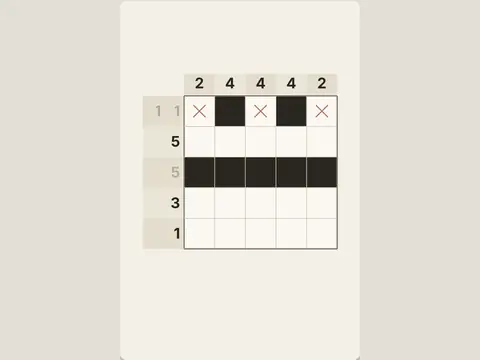

# Picture Cross

**Nonogram picture puzzles.**

▶ **Play:** [https://dougm1966.github.io/1off-1file-games/games/picture-cross/](https://dougm1966.github.io/1off-1file-games/games/picture-cross/) · or open [`index.html`](index.html) in any browser

| | |
|---|---|
| Type | Puzzle |
| Inspired by | nonograms / Picross |
| Built for | phones (portrait, touch); also works with mouse and keyboard |

## How it plays

Fill the grid from the row and column clues to reveal a lab-themed picture, from 5×5 up to 15×15.

> The numbers give the runs of filled squares in each row and column, in order. Fill the grid to reveal the picture.

## Controls

Tap or drag to fill; switch to ✕ to mark empty squares; Hint reveals a square.

## Settings

| Setting | Options |
|---|---|
| Mistakes | Checked · 3 strikes · Unchecked |
| Auto-mark finished lines | On · Off |
| Hints per puzzle | None · 1 · 3 |

## Levels

1. 5×5 · Easy
2. 5×5 · Easy
3. 5×5 · Easy
4. 5×5 · Easy
5. 5×5 · Easy
6. 10×10 · Medium
7. 10×10 · Medium
8. 10×10 · Medium
9. 10×10 · Medium
10. 10×10 · Medium
11. 15×15 · Hard
12. 15×15 · Hard
13. 15×15 · Hard
14. 15×15 · Hard
15. 15×15 · Hard

Levels unlock as you clear them.

## Challenges

A checklist in the menu that saves on your device:

- [ ] Finish all five 5×5 puzzles
- [ ] Solve a puzzle with zero mistakes (checked mode)
- [ ] Solve without hints
- [ ] Solve a 10×10 in under 2 minutes
- [ ] Solve a 15×15
- [ ] Solve all 15 puzzles

## Look and feel

- Type: DM Serif Display for display, system UI for body text
- Palette: background #f3efe6, text #2a2620, accent #2f6f8f
- Layout: logical canvas 360×540, scaled to fit the screen

## Technical notes

- One self-contained HTML file: inline CSS and JavaScript, no build step, no libraries. The only external request is Google Fonts, with system-font fallbacks.
- Settings, unlocked levels, best scores and challenges are stored in the browser's `localStorage`, per device.
- Respects phone safe areas (notches) and never scrolls sideways.
- Recreate or remix it with [`PROMPT.md`](PROMPT.md).
