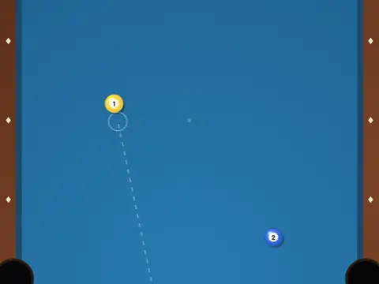

# Pocket Puzzle Duel

**Pass-and-play pool trick-shot puzzles.**

▶ **Play:** [https://dougm1966.github.io/1off-1file-games/games/pocket-puzzle-duel/](https://dougm1966.github.io/1off-1file-games/games/pocket-puzzle-duel/) · or open [`index.html`](index.html) in any browser

| | |
|---|---|
| Type | Two players |
| Inspired by | pool trick-shot puzzles |
| Built for | phones (portrait, touch); also works with mouse and keyboard |

## How it plays

Two players take turns on the same pool trick-shot layout across 10 holes; clear the balls in the fewest strokes, golf style.

> Clear the table in the fewest strokes. Slide a finger on the table to turn your aim (it never jumps to your finger), set POWER, press SHOOT. Duel: two players pass the phone. Solo: beat par on 10 puzzles (clear one to unlock the next).

## Controls

Slide a finger anywhere on the table to rotate the cue; it never snaps to your finger. Nudge buttons fine-tune the angle, a slider sets power, and SHOOT is lit whenever a shot is allowed. A guide line shows the first contact and a short deflection hint.

## Rules and features

- A 'Pass to Player 2' card between turns.
- A header mute button and pause button; the game pauses itself when you switch apps.

## Settings

| Setting | Options |
|---|---|
| Mode | Duel · 2 players · Solo puzzles |
| Duel length (holes) | 3 · 6 · 10 |
| Aim help | Line only · Medium · Extra |
| Aim slide speed | Fine · Normal · Quick |
| Table cloth | Blue · Green · Red |
| Sound | On · Off |
| Vibration | On · Off |

## Levels

1. Opening Shot
2. Three Ball
3. Rail Huggers
4. Bumpers
5. The Rack
6. Through the Gate
7. Bank Street
8. Plus Sign
9. Picket Fence
10. Grand Finale

Levels unlock as you clear them.

## Challenges

A checklist in the menu that saves on your device:

- [ ] Clear a table at par or better
- [ ] Clear a table under par
- [ ] Pocket two balls with one shot
- [ ] Pocket a ball after it bounced off a rail
- [ ] Clear a table without a scratch
- [ ] Finish a two-player duel
- [ ] Clear Grand Finale (puzzle 10)

## Look and feel

- Type: Bungee (display) + Barlow / Barlow Condensed
- Palette: dark blue-green pool hall (#0d1317), tournament-blue cloth, walnut rails, brass accent (#d9a845)
- Layout: portrait canvas table 452×812

## Technical notes

- One self-contained HTML file: inline CSS and JavaScript, no build step, no libraries. The only external request is Google Fonts, with system-font fallbacks.
- Settings, unlocked levels, best scores and challenges are stored in the browser's `localStorage`, per device.
- Respects phone safe areas (notches) and never scrolls sideways.
- Recreate or remix it with [`PROMPT.md`](PROMPT.md).
