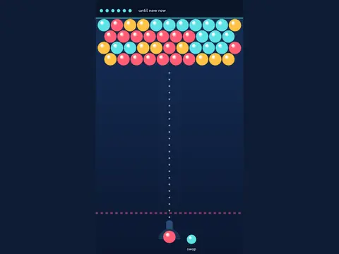

# Pop Lab

**Bubble shooter, 15 levels.**

▶ **Play:** [https://dougm1966.github.io/1off-1file-games/games/pop-lab/](https://dougm1966.github.io/1off-1file-games/games/pop-lab/) · or open [`index.html`](index.html) in any browser

| | |
|---|---|
| Type | Puzzle |
| Inspired by | bubble shooter |
| Built for | phones (portrait, touch); also works with mouse and keyboard |

## How it plays

Match three or more bubbles to pop them; anything left hanging falls for big points. Shots that don't pop anything push a new row down.

> Match three or more of a color to pop them. Anything left hanging falls off for big points. Every few shots that don't pop anything push a new row down.

## Controls

Drag to aim, release to shoot; tap the spare bubble to swap.

## Settings

| Setting | Options |
|---|---|
| Colors | Fewer · By level · More |
| Aim guide | Full + bounce · Short · Off |
| Row pressure | Relaxed · Normal · Fast |

## Levels

1. Warm-up · 3 colors
2. Pyramid
3. Stripes
4. Checkerboard · 4 colors
5. Hourglass
6. Islands
7. Deep rack · 5 colors
8. Zigzag
9. Hanging gardens
10. The wall
11. Diamonds · 6 colors
12. Pillars
13. Spiral-ish
14. Fortress
15. Final rack

Levels unlock as you clear them.

## Challenges

A checklist in the menu that saves on your device:

- [ ] Drop 8+ bubbles with one shot
- [ ] Pop a group with a bank shot off the wall
- [ ] Clear a level before any new row
- [ ] Clear a level in 12 shots or fewer
- [ ] Clear level 10
- [ ] Clear all 15 levels

## Look and feel

- Type: Fredoka for display, system UI for body text
- Palette: background #10203a, text #eef6ff, accent #5ce1e6
- Layout: logical canvas 360×620, scaled to fit the screen

## Technical notes

- One self-contained HTML file: inline CSS and JavaScript, no build step, no libraries. The only external request is Google Fonts, with system-font fallbacks.
- Settings, unlocked levels, best scores and challenges are stored in the browser's `localStorage`, per device.
- Respects phone safe areas (notches) and never scrolls sideways.
- Recreate or remix it with [`PROMPT.md`](PROMPT.md).
