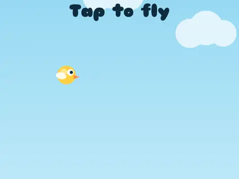

# Puff Flight

**Tap-to-flap flyer.**

▶ **Play:** [https://dougm1966.github.io/1off-1file-games/games/puff-flight/](https://dougm1966.github.io/1off-1file-games/games/puff-flight/) · or open [`index.html`](index.html) in any browser

| | |
|---|---|
| Type | Arcade |
| Inspired by | Flappy Bird-style flyer (original character) |
| Built for | phones (portrait, touch); also works with mouse and keyboard |

## How it plays

Tap to puff upward and glide through gaps. Grab coins; shield bubbles soak up one crash. From 10 points on, some pipes move.

> Tap to puff upward and glide through the gaps. Grab coins. Bubbles give you a shield that soaks up one crash. From 10 points on, some pipes start moving.

## Controls

Tap anywhere (or space) to puff upward.

## Settings

| Setting | Options |
|---|---|
| Difficulty | Easy · Normal · Hard |
| World | Meadow · Dusk · Clean room |
| Bird | Sunny · Bubblegum · Lime |
| Shield bubbles | On · Off |

## Challenges

A checklist in the menu that saves on your device:

- [ ] Score 10
- [ ] Score 25
- [ ] Score 50
- [ ] Score 20 on Hard
- [ ] Grab 10 coins in one flight
- [ ] Squeak through 3 gaps by a feather

## Look and feel

- Type: Sniglet for display, system UI for body text
- Palette: background #7fd0f0, text #0f2b3d, accent #ff8a3d
- Layout: logical canvas 360×620, scaled to fit the screen

## Technical notes

- One self-contained HTML file: inline CSS and JavaScript, no build step, no libraries. The only external request is Google Fonts, with system-font fallbacks.
- Settings, unlocked levels, best scores and challenges are stored in the browser's `localStorage`, per device.
- Respects phone safe areas (notches) and never scrolls sideways.
- Recreate or remix it with [`PROMPT.md`](PROMPT.md).
