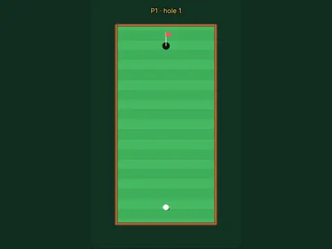

# Putt Party

**18-hole mini golf for 1-4 players.**

▶ **Play:** [https://dougm1966.github.io/1off-1file-games/games/putt-party/](https://dougm1966.github.io/1off-1file-games/games/putt-party/) · or open [`index.html`](index.html) in any browser

| | |
|---|---|
| Type | Two players |
| Inspired by | mini golf |
| Built for | phones (portrait, touch); also works with mouse and keyboard |

## How it plays

Eighteen holes of mini golf with windmills, sand, water, bumpers, slopes and moving obstacles, for one to four players on one phone.

> Eighteen holes of mini golf with windmills, sand, water and slopes. Up to four players take turns on one phone.

## Controls

Drag back anywhere like a slingshot and release to putt; the arrow shows direction and power.

## Settings

| Setting | Options |
|---|---|
| Players | 1 · 2 · 3 · 4 |
| Max strokes per hole | 6 · 8 · 10 |
| Aim arrow | On · Off |

## Levels

1. Front nine
2. Back nine
3. All eighteen

Levels unlock as you clear them.

## Challenges

A checklist in the menu that saves on your device:

- [ ] Make a hole in one
- [ ] Make a birdie
- [ ] Finish a round under par
- [ ] Finish a round without hitting water
- [ ] Play all 18
- [ ] Finish a multiplayer round

## Look and feel

- Type: Lilita One for display, system UI for body text
- Palette: background #123222, text #f2fbe9, accent #ffd34d
- Layout: logical canvas 360×600, scaled to fit the screen

## Technical notes

- One self-contained HTML file: inline CSS and JavaScript, no build step, no libraries. The only external request is Google Fonts, with system-font fallbacks.
- Settings, unlocked levels, best scores and challenges are stored in the browser's `localStorage`, per device.
- Respects phone safe areas (notches) and never scrolls sideways.
- Recreate or remix it with [`PROMPT.md`](PROMPT.md).
