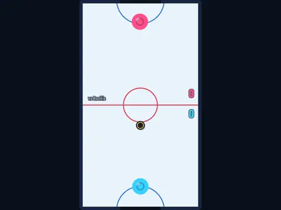

# Rink Rivals

**Air hockey, two players on one phone or a CPU ladder.**

▶ **Play:** [https://dougm1966.github.io/1off-1file-games/games/rink-rivals/](https://dougm1966.github.io/1off-1file-games/games/rink-rivals/) · or open [`index.html`](index.html) in any browser

| | |
|---|---|
| Type | Two players |
| Inspired by | air hockey |
| Built for | phones (portrait, touch); also works with mouse and keyboard |

## How it plays

Air hockey on one phone: two players each hold an end, or one player climbs a ten-opponent CPU ladder.

> Drag a finger on your half and your paddle follows just ahead of it. Hit the puck into the other goal. Two players: lay the phone flat, one at each end, and play at the same time. Solo: climb 10 CPU opponents.

## Controls

Each half of the rink is tinted in its player's colour and labelled. A finger belongs to the half where it first touched and keeps controlling that paddle until it lifts, even if it crosses the centre line, so two players never interfere. The paddle sits a little ahead of your finger so you can see it.

## Rules and features

- Settings for mode, score to win and puck speed; 7 challenges.
- A header mute button and pause button; the game pauses itself when you switch apps.

## Settings

| Setting | Options |
|---|---|
| Mode | Vs CPU ladder · Two players |
| First to | 5 · 7 · 11 |
| Puck | Chill · Normal · Fast |
| Paddle size | Normal · Big |
| Sound | On · Off |
| Vibration | On · Off |

## Levels

1. Rookie
2. Junior
3. Club
4. Varsity
5. Semi-pro
6. Pro
7. All-star
8. Veteran
9. Champion
10. Legend

Levels unlock as you clear them.

## Challenges

A checklist in the menu that saves on your device:

- [ ] Win against the CPU without letting one in
- [ ] Win after being down by 3
- [ ] Score within 3.5 seconds of a faceoff
- [ ] Score with a top-speed shot
- [ ] Beat the Semi-pro (level 5)
- [ ] Beat the Legend (level 10)
- [ ] Finish a two-player match

## Look and feel

- Type: Saira Condensed for display, system UI for body text
- Palette: background #0b1220, text #eef5ff, accent #36d1ff
- Layout: logical canvas 360×620, scaled to fit the screen

## Technical notes

- One self-contained HTML file: inline CSS and JavaScript, no build step, no libraries. The only external request is Google Fonts, with system-font fallbacks.
- Settings, unlocked levels, best scores and challenges are stored in the browser's `localStorage`, per device.
- Respects phone safe areas (notches) and never scrolls sideways.
- Recreate or remix it with [`PROMPT.md`](PROMPT.md).
