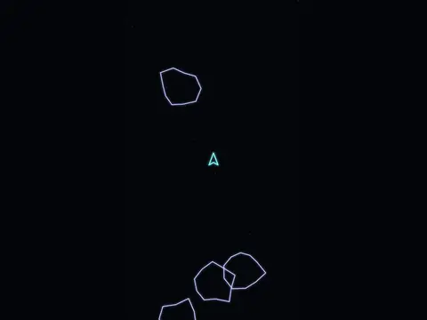

# Rock Field

**Asteroids-style vector shooter.**

▶ **Play:** [https://dougm1966.github.io/1off-1file-games/games/rock-field/](https://dougm1966.github.io/1off-1file-games/games/rock-field/) · or open [`index.html`](index.html) in any browser

| | |
|---|---|
| Type | Arcade |
| Inspired by | Asteroids |
| Built for | phones (portrait, touch); also works with mouse and keyboard |

## How it plays

Vector-style rock blasting: big rocks split into smaller, faster pieces.

> Blast the drifting rocks. Big ones split into smaller, faster pieces.
> Touch and hold where you want to go. The ship turns toward your finger, thrusts when it's far away, and fires when it's lined up.

## Controls

Touch and hold: the ship turns toward your finger, thrusts when your finger is far away, and fires when lined up. Arrow keys plus space also work.

## Rules and features

- Respawn invulnerability; extra points each level.
- Best score saved.

## Look and feel

- Type: Audiowide for display, system UI for body text
- Palette: background #05060a, text #f2f4ff, accent #7df9ff
- Layout: logical canvas 360×640, scaled to fit the screen

## Technical notes

- One self-contained HTML file: inline CSS and JavaScript, no build step, no libraries. The only external request is Google Fonts, with system-font fallbacks.
- Settings, unlocked levels, best scores and challenges are stored in the browser's `localStorage`, per device.
- Respects phone safe areas (notches) and never scrolls sideways.
- Recreate or remix it with [`PROMPT.md`](PROMPT.md).
