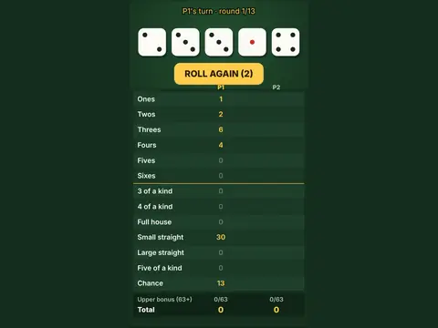

# Roll Call

**Five-dice scorecard game for 1–4 or vs CPU.**

▶ **Play:** [https://dougm1966.github.io/1off-1file-games/games/roll-call/](https://dougm1966.github.io/1off-1file-games/games/roll-call/) · or open [`index.html`](index.html) in any browser

| | |
|---|---|
| Type | Two players |
| Inspired by | five-dice scorecard games |
| Built for | phones (portrait, touch); also works with mouse and keyboard |

## How it plays

Five dice, thirteen categories. Roll up to three times a turn, hold the dice you want, then score one row. Upper-section bonus at 63 and bonus fives.

> Five dice and thirteen rows. Roll up to three times a turn, hold the dice you like, then score one row. Each row only gets used once. Hit 63 in the top section for a 35-point bonus.

## Controls

Tap Roll, tap dice to hold them, tap a scorecard row to score it. Possible scores preview in gold.

## Settings

| Setting | Options |
|---|---|
| Players | Solo · 2 · 3 · 4 · Vs CPU |
| Show possible scores | On · Off |
| Five of a kind counts as full house | On · Off |

## Challenges

A checklist in the menu that saves on your device:

- [ ] Roll five of a kind
- [ ] Score a large straight on the first roll
- [ ] Earn the upper-section bonus
- [ ] Score 250+ in a game
- [ ] Score 300+ in a game
- [ ] Beat the CPU

## Look and feel

- Type: Bowlby One for display, system UI for body text
- Palette: background #16301f, text #f3f7ef, accent #ffcc4d
- Layout: logical canvas 360×660, scaled to fit the screen

## Technical notes

- One self-contained HTML file: inline CSS and JavaScript, no build step, no libraries. The only external request is Google Fonts, with system-font fallbacks.
- Settings, unlocked levels, best scores and challenges are stored in the browser's `localStorage`, per device.
- Respects phone safe areas (notches) and never scrolls sideways.
- Recreate or remix it with [`PROMPT.md`](PROMPT.md).
