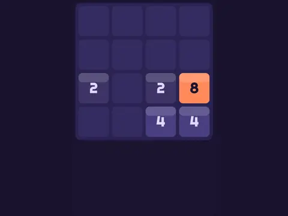

# Slide & Merge

**2048-style sliding merge puzzle.**

▶ **Play:** [https://dougm1966.github.io/1off-1file-games/games/slide-and-merge/](https://dougm1966.github.io/1off-1file-games/games/slide-and-merge/) · or open [`index.html`](index.html) in any browser

| | |
|---|---|
| Type | Puzzle |
| Inspired by | 2048 |
| Built for | phones (portrait, touch); also works with mouse and keyboard |

## How it plays

Slide every tile at once; matching tiles merge into their sum. Reach the goal tile before the board fills.

> Swipe to slide every tile at once. Two matching tiles merge into their sum. Reach the goal tile before the board fills up.

## Controls

Swipe to slide; Undo and Restart buttons. Arrow keys also work.

## Settings

| Setting | Options |
|---|---|
| Board | 4×4 · 5×5 · 6×6 |
| Undos | None · 3 · Unlimited |
| Rock tiles | Off · On |

## Levels

1. Reach 128
2. Reach 256
3. Reach 512
4. Reach 1024
5. Reach 2048
6. Reach 4096
7. Reach 8192

Levels unlock as you clear them.

## Challenges

A checklist in the menu that saves on your device:

- [ ] Reach any goal tile
- [ ] Make a 2048 tile
- [ ] Reach a goal in fewer moves than 0.6 × the goal
- [ ] Make 512 on 4×4 with rocks on
- [ ] Make 1024 on 6×6

## Look and feel

- Type: Righteous for display, system UI for body text
- Palette: background #1b1530, text #f5f0ff, accent #ffb547
- Layout: logical canvas 360×540, scaled to fit the screen

## Technical notes

- One self-contained HTML file: inline CSS and JavaScript, no build step, no libraries. The only external request is Google Fonts, with system-font fallbacks.
- Settings, unlocked levels, best scores and challenges are stored in the browser's `localStorage`, per device.
- Respects phone safe areas (notches) and never scrolls sideways.
- Recreate or remix it with [`PROMPT.md`](PROMPT.md).
