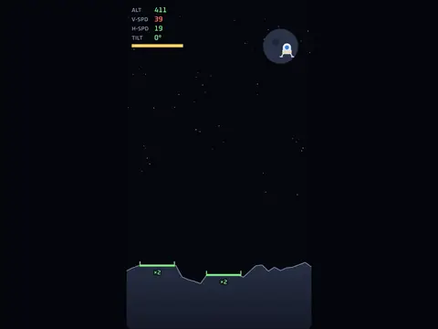

# Soft Landing

**Lunar lander, 10 levels.**

▶ **Play:** [https://dougm1966.github.io/1off-1file-games/games/soft-landing/](https://dougm1966.github.io/1off-1file-games/games/soft-landing/) · or open [`index.html`](index.html) in any browser

| | |
|---|---|
| Type | Arcade |
| Inspired by | Lunar Lander |
| Built for | phones (portrait, touch); also works with mouse and keyboard |

## How it plays

Set a lander down gently on a lit pad. Come in slow and level; ×2/×3/×5 pads and stronger gravity pay more.

> Set the lander down gently on a lit pad. Come in slow and level. Higher-multiplier pads and stronger gravity pay more.

## Controls

Hold anywhere to fire the engine; slide while holding to tilt.

## Settings

| Setting | Options |
|---|---|
| Gravity | Moon · Mars · Earth |
| Fuel | Generous · Standard · Tight |
| Wind | Off · By level · Always |

## Levels

1. Wide pads, calm sky
2. Rolling hills
3. Two pads, one tight
4. Light crosswind
5. Jagged ridge
6. Narrow canyon
7. Gusty wind
8. Tiny ×5 ledge
9. Storm front
10. The needle

Levels unlock as you clear them.

## Challenges

A checklist in the menu that saves on your device:

- [ ] Land on a ×5 pad
- [ ] Touch down under 10 px/s
- [ ] Land with over half your fuel left
- [ ] Land in Earth gravity
- [ ] Land without tilting at all
- [ ] Clear level 10

## Look and feel

- Type: Oxanium for display, system UI for body text
- Palette: background #05070d, text #e8f0ff, accent #ffd166
- Layout: logical canvas 360×640, scaled to fit the screen

## Technical notes

- One self-contained HTML file: inline CSS and JavaScript, no build step, no libraries. The only external request is Google Fonts, with system-font fallbacks.
- Settings, unlocked levels, best scores and challenges are stored in the browser's `localStorage`, per device.
- Respects phone safe areas (notches) and never scrolls sideways.
- Recreate or remix it with [`PROMPT.md`](PROMPT.md).
