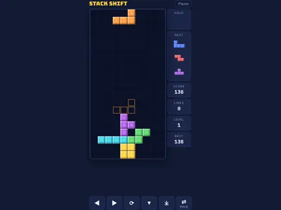

# Stack Shift

**Falling-blocks stacker.**

▶ **Play:** [https://dougm1966.github.io/1off-1file-games/games/stack-shift/](https://dougm1966.github.io/1off-1file-games/games/stack-shift/) · or open [`index.html`](index.html) in any browser

| | |
|---|---|
| Type | Puzzle |
| Inspired by | Tetris-style falling blocks |
| Built for | phones (portrait, touch); also works with mouse and keyboard |

## How it plays

Falling-block stacking with a seven-piece bag, ghost piece, hold and three-piece preview. Marathon, 40-line Sprint and 2-minute Ultra modes.

> Slide falling blocks into full rows to clear them. Use ◀ ▶ and ▼ on one side, and ROTATE, DROP and HOLD on the other. Hold ◀ or ▶ to keep sliding. Pick a start level; reach higher levels in Marathon to unlock more.

## Controls

Buttons under the board: ◀ ▶ (hold to slide) and ▼ soft drop on the left; ROTATE, DROP and HOLD on the right. Board gestures (drag, tap to rotate, swipe down to drop) are an optional extra.

## Rules and features

- 10 start levels that unlock, and 7 challenges.
- A header mute button and pause button; the game pauses itself when you switch apps.

## Settings

| Setting | Options |
|---|---|
| Mode | Marathon · 40-line sprint · Ultra 2:00 |
| Ghost piece | On · Off |
| Hold-to-repeat speed | Quick · Normal · Relaxed |
| Board gestures too | Off · On |
| Controls side | Buttons right · Buttons left |
| Sound | On · Off |
| Vibration | On · Off |

## Levels

1. Level 1
2. Level 2
3. Level 3
4. Level 4
5. Level 5
6. Level 6
7. Level 7
8. Level 8
9. Level 9
10. Level 10

Levels unlock as you clear them.

## Challenges

A checklist in the menu that saves on your device:

- [ ] Reach level 5
- [ ] Clear 4 rows at once
- [ ] Land a T-spin
- [ ] Chain 4 clears in a row
- [ ] Two Tetris/T-spin clears back to back
- [ ] Finish a 40-line sprint
- [ ] Score 3000 in Ultra

## Look and feel

- Type: Bungee + Space Mono
- Palette: navy (#121a33) with yellow accent (#ffcf3f); bevelled blocks in the classic seven colors
- Layout: board canvas plus side rail for hold/next/score

## Technical notes

- One self-contained HTML file: inline CSS and JavaScript, no build step, no libraries. The only external request is Google Fonts, with system-font fallbacks.
- Settings, unlocked levels, best scores and challenges are stored in the browser's `localStorage`, per device.
- Respects phone safe areas (notches) and never scrolls sideways.
- Recreate or remix it with [`PROMPT.md`](PROMPT.md).
