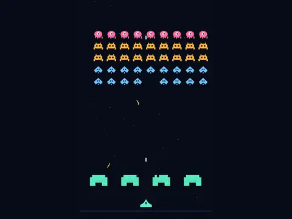

# Star Siege

**Space Invaders-style shooter.**

▶ **Play:** [https://dougm1966.github.io/1off-1file-games/games/star-siege/](https://dougm1966.github.io/1off-1file-games/games/star-siege/) · or open [`index.html`](index.html) in any browser

| | |
|---|---|
| Type | Arcade |
| Inspired by | Space Invaders |
| Built for | phones (portrait, touch); also works with mouse and keyboard |

## How it plays

Hold the line against marching alien ranks across 10 sectors, ending with a flagship boss. Shield bunkers wear down as they take hits.

> Hold the line against the descending fleet. Hold ◀ ▶ to move and the big FIRE button to shoot, at the same time. Shields soak shots but crumble. Hit the red saucer for bonus points.

## Controls

◀ ▶ hold buttons on the left and a big FIRE button on the right; moving and firing at the same time works. Auto-fire is a setting. An alternative 'Drag ship' mode moves the ship by relative drag with auto-fire.

## Rules and features

- 10 sectors that unlock, and 7 challenges.
- A header mute button and pause button; the game pauses itself when you switch apps.

## Settings

| Setting | Options |
|---|---|
| Difficulty | Easy · Normal · Hard |
| Controls | ◀ ▶ + FIRE · Drag ship |
| Auto-fire (buttons mode) | Off · On |
| Lives | 3 · 5 |
| Shield bunkers | On · Off |
| Controls side | Buttons right · Buttons left |
| Sound | On · Off |
| Vibration | On · Off |

## Levels

1. First Contact
2. Scout Fleet
3. Full Armada
4. Raiders
5. Armored Ranks
6. Crossfire
7. Iron Wall
8. Low Orbit
9. Elite Guard
10. The Flagship

Levels unlock as you clear them.

## Challenges

A checklist in the menu that saves on your device:

- [ ] Clear sector 1
- [ ] Shoot down the red saucer
- [ ] Hit 12 shots in a row without a miss
- [ ] Clear a sector without losing a ship
- [ ] Clear a sector in under 45 seconds
- [ ] Score 3000 points in one game
- [ ] Destroy the Flagship (sector 10)

## Look and feel

- Type: Orbitron for display, system UI for body text
- Palette: background #070b18, text #e6f0ff, accent #5cf2c4
- Layout: logical canvas 360×600, scaled to fit the screen

## Technical notes

- One self-contained HTML file: inline CSS and JavaScript, no build step, no libraries. The only external request is Google Fonts, with system-font fallbacks.
- Settings, unlocked levels, best scores and challenges are stored in the browser's `localStorage`, per device.
- Respects phone safe areas (notches) and never scrolls sideways.
- Recreate or remix it with [`PROMPT.md`](PROMPT.md).
