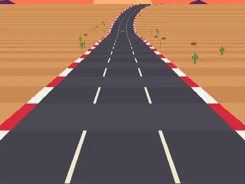

# Sunset Run

**Pseudo-3D desert driving.**

▶ **Play:** [https://dougm1966.github.io/1off-1file-games/games/sunset-run/](https://dougm1966.github.io/1off-1file-games/games/sunset-run/) · or open [`index.html`](index.html) in any browser

| | |
|---|---|
| Type | Arcade |
| Inspired by | OutRun-style pseudo-3D racing |
| Built for | phones (portrait, touch); also works with mouse and keyboard |

## How it plays

Drive a red sports car down a winding desert highway at sunset, weaving through traffic and reaching checkpoints before the clock runs out.

## Controls

Slide a finger left or right anywhere on the screen; the car follows the slide. Gas is automatic. Arrow keys also steer.

## Rules and features

- Curves push the car outward; running off the asphalt slows you down.
- Each checkpoint adds time; traffic gets slightly faster as you go.
- Best distance is saved.

## Look and feel

- Type: Russo One + Chakra Petch
- Palette: synthwave sunset: purple-to-orange sky, striped sun, desert sand, red-and-white rumble strips, orange accent (#ffb238)
- Layout: full-screen canvas, horizon 30% down

## Technical notes

- One self-contained HTML file: inline CSS and JavaScript, no build step, no libraries. The only external request is Google Fonts, with system-font fallbacks.
- Settings, unlocked levels, best scores and challenges are stored in the browser's `localStorage`, per device.
- Respects phone safe areas (notches) and never scrolls sideways.
- Recreate or remix it with [`PROMPT.md`](PROMPT.md).
