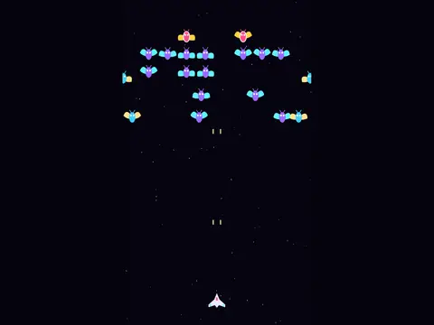

# Swarm Wing

**Galaga-style swooping shooter.**

▶ **Play:** [https://dougm1966.github.io/1off-1file-games/games/swarm-wing/](https://dougm1966.github.io/1off-1file-games/games/swarm-wing/) · or open [`index.html`](index.html) in any browser

| | |
|---|---|
| Type | Arcade |
| Inspired by | Galaga |
| Built for | phones (portrait, touch); also works with mouse and keyboard |

## How it plays

A swarm loops in on curved paths, forms up, then peels off to dive at your twin-cannon fighter. Hits during a dive score double; pink leaders take two hits.

> The swarm loops in, forms up, then peels off to dive at you. Hits during a dive score double.
> Slide anywhere to move. Twin cannons fire on their own. Pink leaders take two hits.

## Controls

Slide anywhere to move; twin cannons fire automatically.

## Rules and features

- Three lives, waves get faster.
- Best score saved.

## Look and feel

- Type: Exo 2 for display, system UI for body text
- Palette: background #06040f, text #f1ecff, accent #ffd23f
- Layout: logical canvas 360×620, scaled to fit the screen

## Technical notes

- One self-contained HTML file: inline CSS and JavaScript, no build step, no libraries. The only external request is Google Fonts, with system-font fallbacks.
- Settings, unlocked levels, best scores and challenges are stored in the browser's `localStorage`, per device.
- Respects phone safe areas (notches) and never scrolls sideways.
- Recreate or remix it with [`PROMPT.md`](PROMPT.md).
