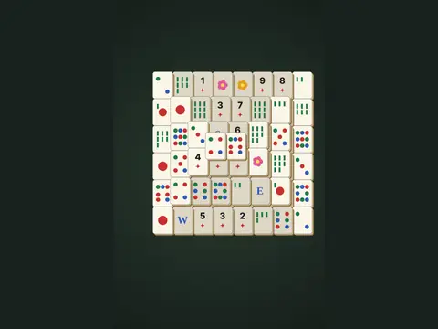

# Tile Temple

**Mahjong solitaire.**

▶ **Play:** [https://dougm1966.github.io/1off-1file-games/games/tile-temple/](https://dougm1966.github.io/1off-1file-games/games/tile-temple/) · or open [`index.html`](index.html) in any browser

| | |
|---|---|
| Type | Puzzle |
| Inspired by | Mahjong solitaire |
| Built for | phones (portrait, touch); also works with mouse and keyboard |

## How it plays

Match pairs of free tiles (not covered and open on the left or right) to clear stacked layouts.

> Mahjong solitaire. Clear the stack by matching identical pairs. A tile is free when nothing sits on it and its left or right side is open. Every deal can be solved.

## Controls

Tap two matching free tiles.

## Settings

| Setting | Options |
|---|---|
| Dim blocked tiles | On · Off |
| Hints | None · 3 · Unlimited |
| Shuffles | None · 1 · 3 |

## Levels

1. Pyramid
2. Bridge
3. Twin towers
4. Diamond

Levels unlock as you clear them.

## Challenges

A checklist in the menu that saves on your device:

- [ ] Clear any layout
- [ ] Clear without hints
- [ ] Clear in under 4 minutes
- [ ] Clear the Diamond
- [ ] Clear all four layouts

## Look and feel

- Type: Cinzel for display, system UI for body text
- Palette: background #1a2420, text #f3efe2, accent #e0b34f
- Layout: logical canvas 360×560, scaled to fit the screen

## Technical notes

- One self-contained HTML file: inline CSS and JavaScript, no build step, no libraries. The only external request is Google Fonts, with system-font fallbacks.
- Settings, unlocked levels, best scores and challenges are stored in the browser's `localStorage`, per device.
- Respects phone safe areas (notches) and never scrolls sideways.
- Recreate or remix it with [`PROMPT.md`](PROMPT.md).
