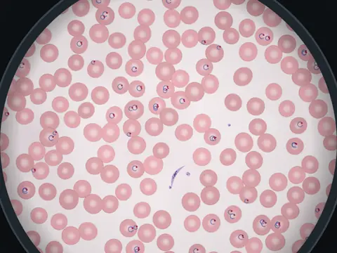

# Under the Scope

**Identify blood smears, Gram stains and urine sediment.**

▶ **Play:** [https://dougm1966.github.io/1off-1file-games/games/under-the-scope/](https://dougm1966.github.io/1off-1file-games/games/under-the-scope/) · or open [`index.html`](index.html) in any browser

| | |
|---|---|
| Type | Lab |
| Inspired by | microscope identification |
| Built for | phones (portrait, touch); also works with mouse and keyboard |

## How it plays

Identify what you see in realistic microscope fields: blood smears, Gram and acid-fast stains, and urine sediment, at student, tech or pathologist level.

> Name what is under the microscope: blood smears, Gram and acid-fast stains, urine sediment. Tap ZOOM for 2× and drag to pan, then tap one of the answers. Every answer explains the key features.

## Controls

Answer buttons under the eyepiece. A Zoom button switches between 1× and 2×; when zoomed, drag one finger to pan.

## Rules and features

- Solo or pass-and-play for 2–4; settings for specimen types, level, number of fields and clock.
- A header mute button and pause button; the game pauses itself when you switch apps.

## Settings

| Setting | Options |
|---|---|
| Players | Solo · 2 · 3 · 4 |
| Specimens | All · Blood · Stains · Urine |
| Level | Student · Tech · Path |
| Fields each | 5 · 10 · 15 · 20 |
| Clock | By level · Off · 15 s · 30 s · 60 s |
| Sound | On · Off |
| Vibration | On · Off |

## Challenges

A checklist in the menu that saves on your device:

- [ ] Identify 5 fields in a row
- [ ] Finish a solo round of 5+ fields with none wrong
- [ ] Get 5 right in one round after zooming in on each
- [ ] Identify 5 urine sediment fields in one round
- [ ] Get 5 right at Pathologist level in one round
- [ ] Finish a round with 3 or 4 players

## Look and feel

- Type: IBM Plex Sans / Condensed / Mono
- Palette: dark UI (#0e1114) around a circular eyepiece with vignette and grain; Wright-stain pinks/purples, Gram stain pinks/purples, blue AFB counterstain, beige unstained urine
- Layout: canvas 760×760 eyepiece

## Technical notes

- One self-contained HTML file: inline CSS and JavaScript, no build step, no libraries. The only external request is Google Fonts, with system-font fallbacks.
- Settings, unlocked levels, best scores and challenges are stored in the browser's `localStorage`, per device.
- Respects phone safe areas (notches) and never scrolls sideways.
- Recreate or remix it with [`PROMPT.md`](PROMPT.md).
